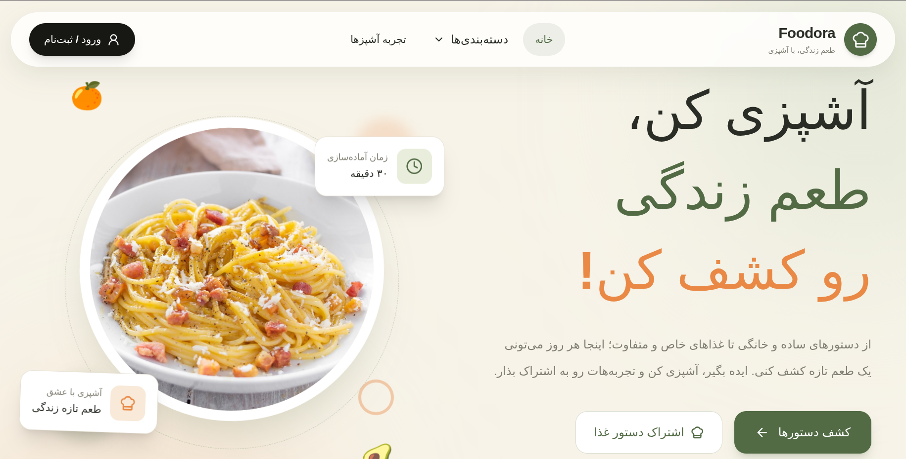
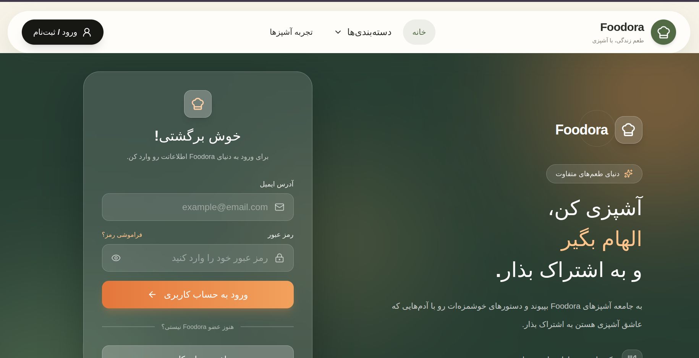
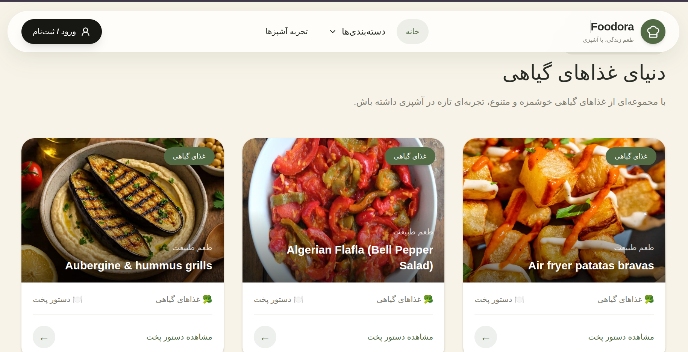
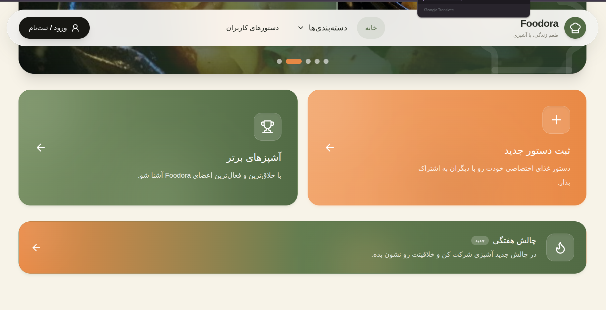
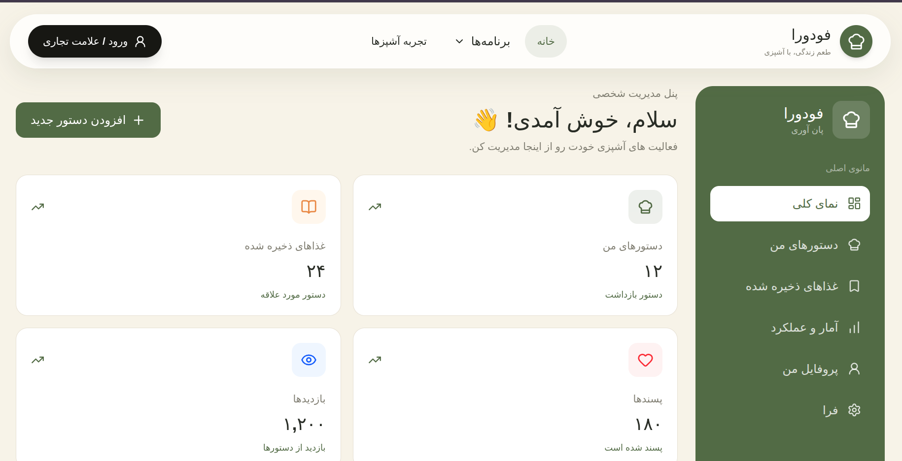
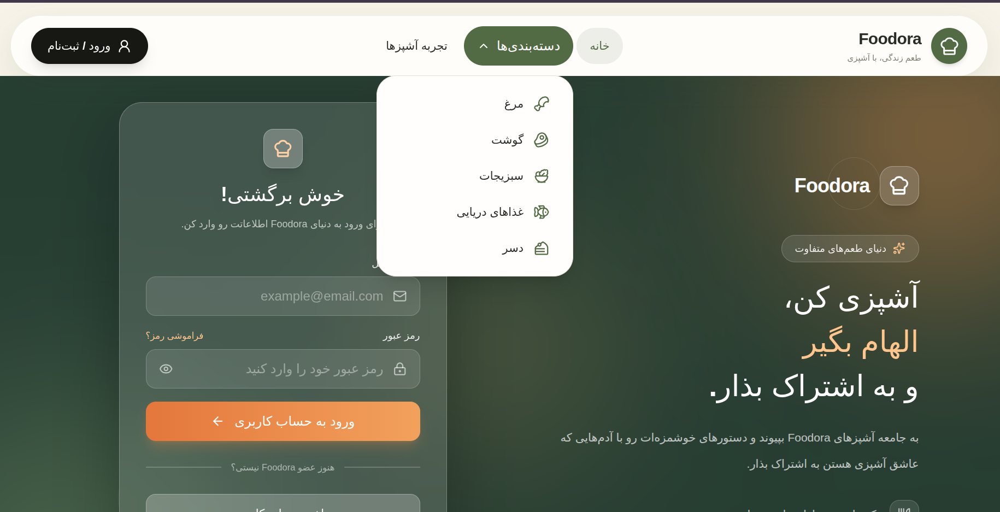

# 🍽️ Foodora
## 📸 Screenshots

### Home Page


### Recipes



### Recipe Details


### Community


### Dashbord


### Login

### A Modern Cooking & Recipe Sharing Platform

Foodora is a modern, responsive cooking platform built with **React, TypeScript, and Vite**. It provides a friendly space for discovering recipes, exploring cooking ideas, and sharing culinary experiences.

## ✨ Features

- Browse recipes across different food categories
- View detailed recipe information
- Search and explore recipes
- Discover top chefs
- Join the cooking community
- Participate in weekly cooking challenges
- Read and share recipe reviews
- User registration and login interfaces
- Responsive design for desktop and mobile devices

## 🛠️ Tech Stack

- React
- TypeScript
- Vite
- Tailwind CSS
- React Router
- Lucide React

## 🚀 Getting Started

### 1. Clone the repository

```bash
git clone https://github.com/Safaeii/Foodora.git
```

### 2. Navigate to the project

```bash
cd Foodora
```

### 3. Install dependencies

```bash
npm install
```

### 4. Start the development server

```bash
npm run dev
```

Open the local URL shown in your terminal to view the application.

## 📁 Project Structure

```text
src/
├── components/
├── pages/
├── assets/
├── types/
├── App.tsx
└── main.tsx
```

## 🎨 Design

Foodora uses a warm, modern visual identity with a carefully selected color palette, clean layouts, and responsive components to create an enjoyable cooking experience.

## 👩‍💻 Developer

**Safaeii**

- GitHub: [@Safaeii](https://github.com/Safaeii)

---

Made with ❤️ and passion for cooking.
